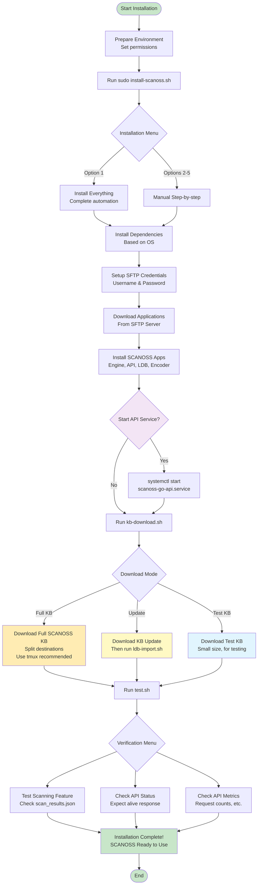

# SCANOSS On-Premise

## Table of Contents

- [TL;DR](#tl;dr)
- [Introduction](#introduction)
- [Hardware Requirements](#hardware-requirements)
  - [Full Knowledge Base Requirements](#full-knowledge-base-requirements)
  - [Test Knowledge Base Requirements](#test-knowledge-base-requirements)
- [Repository Contents](#repository-contents)
- [Installation Guide](#installation-guide)
  - [Preparing the Environment](#preparing-the-environment)
  - [System Dependencies](#system-dependencies)
  - [Installing SCANOSS Applications](#installing-scanoss-applications)
  - [Knowledge Base Download (kb-download.sh)](#knowledge-base-download-kb-downloadsh)
    - [KB Download Prerequisites](#kb-download-prerequisites)
    - [Running the Script](#running-the-script)
    - [Command-line Options](#command-line-options)
    - [How it Works](#how-it-works)
    - [Example Sessions](#example-sessions)
    - [Verifying a KB Update](#verifying-a-kb-update)
  - [Automated Updates (scanoss-update.sh)](#automated-updates-scanoss-updatesh)
  - [Verifying Installation](#verifying-installation)
- [Configuration](#configuration)
    - [Manual Installation Workflow](#manual-installation-workflow)
    - [API Service Management](#api-service-management)
    - [API Configuration](#api-configuration)
- [Testing the Installer](#testing-the-installer)
- [Installation Flow Diagram](#installation-flow-diagram)

- [Support](#support)

---

## TL;DR 

1. Clone this repository: ```git clone https://github.com/scanoss/on-premise.git```
2. Add execution permissions to the installation scripts: ```cd on-premise/install/ && chmod +x *.sh```
3. Run the install-scanoss.sh script: ```sudo ./install-scanoss.sh```
4. Choose option 1) Install everything
5. Run the kb-download.sh script: ```./kb-download.sh``` and choose what to download (full KB, an update, the test KB, a SQLite KB snapshot, or an HFH KB snapshot). If you downloaded a KB update, run the `ldb-import.sh` script included in the download folder to import it into your local LDB.
6. Installation finished!

## Introduction

This document aims to guide users through the process of installing SCANOSS for on-premise environments.

This repository contains all necessary scripts for installing the SCANOSS Knowledge Base (SCANOSS KB), SCANOSS applications (engine, ldb, api and scanoss-encoder), dependencies, knowledge base updates and verifying a correct installation of every component.

To visualize the installation workflow, make sure to see the [Installation Flow Diagram](#installation-flow-diagram) at the end of this guide.

## Hardware Requirements

During installation you will be able to choose between installing the SCANOSS KB or the Test KB (which should only be used for testing, as it's not the complete knowledge base).

### Full Knowledge Base Requirements

The following is recommended for running the SCANOSS Applications and SCANOSS KB:

- Operating systems supported: Debian 11/12 and CentOS

|     | Minimum                   | Recommended               |
|-----|---------------------------|---------------------------|
| **CPU** | 8 Core x64 - 3.5 Ghz      | 32 Core x64 - 3.6 Ghz     |
| **RAM** | 32GB                      | 128GB                     |
| **HDD** | 25.0TB SSD (NVMe preferred) | 27.0TB SSD (NVMe preferred) |

### Test Knowledge Base Requirements

The following is recommended for running the SCANOSS Applications and SCANOSS Test KB:

- Operating systems supported: Debian 11/12 and CentOS

|     | Minimum                   | Recommended               |
|-----|---------------------------|---------------------------|
| **CPU** | 8 Core x64 - 3.5 Ghz      | 32 Core x64 - 3.6 Ghz     |
| **RAM** | 16GB                      | 32GB                      |
| **HDD** | 700GB SSD (NVMe preferred)| 1TB SSD (NVMe preferred)  | 

## Repository Contents

- [install-scanoss.sh](./install-scanoss.sh): bash script for installing SCANOSS (SFTP user setup creation, dependencies installation and application download/install)
- [kb-download.sh](./kb-download.sh): bash script for downloading the full KB, KB updates, the test KB, a SQLite KB snapshot, or an HFH KB snapshot from the SCANOSS SFTP server. KB update downloads ship with an `ldb-import.sh` helper that imports the update into your local LDB.
- [scanoss-update.sh](./scanoss-update.sh): non-interactive wrapper meant for scheduled jobs (e.g. cron): updates the SCANOSS binaries (via `install-scanoss.sh`) and, optionally, deploys the full KB (via `kb-download.sh` or from a local folder)
- [test.sh](./test.sh): bash script for verifying the correct installation of SCANOSS and the SCANOSS KB
- [resources](/resources): directory containing files for testing the installation of SCANOSS and the SCANOSS KB
- [config.sh](./config.sh): configuration file
- [tests](./tests): tests for the installation scripts (see [Testing the Installer](#testing-the-installer))

## Installation Guide

### Preparing The Environment 

You will receive en email from our Sales team containing the credentials to access our SFTP server, take note of those credentials as we are going to use them during the installation.

The first step would be cloning this repository using git:

```
git clone https://github.com/scanoss/on-premise.git
```

Make sure the scripts have execution permissions, if not add them with the following command:

```
cd on-premise/install/
chmod +x *.sh
```

> **_Note:_** The `install-scanoss.sh` script needs to be run as root, either using ```sudo``` or directly as the root user. The `kb-download.sh` script can be run as a regular user.

### System Dependencies

Option 2) Install system dependencies of ```install-scanoss.sh``` (also run by option 1) installs the following packages:

| Debian package | RHEL / Rocky package | Required by | Used for |
|---|---|---|---|
| `gzip`, `tar` | `gzip`, `tar` | `install-scanoss.sh`, API, decoration services | Extracting the API, decoration services and encoder packages; the API's and services' startup scripts compress log backups |
| `findutils` | `findutils` | `install-scanoss.sh` | Locating the downloaded packages (`find`) |
| `lftp` | `lftp` | `install-scanoss.sh`, `kb-download.sh`, `scanoss-update.sh` | Downloading components and the KB from the SFTP server |
| `openssh-client` | `openssh-clients` | `lftp`, `kb-download.sh` | SSH transport used by `lftp` for SFTP, and `sftp` when `kb-download.sh` uses it instead of `lftp` |
| `sshpass` | `sshpass` (EPEL) | `kb-download.sh` | Password authentication, only when downloading with `sftp` (`-d sftp`, or when `lftp` is not installed) |
| `curl` | `curl` (only if missing) | `test.sh`, decoration services (all except `components`) | Test requests to the API; the services' `env-setup.sh` download default configuration files |
| `libsodium23` | `libsodium` (EPEL) | scanoss-encoder | Shared library `libsodium.so.23` |
| `libgcrypt20` | `libgcrypt` | engine, ldb (and scanoss-encoder, through `libldb.so`) | Shared library `libgcrypt.so.20` |
| — | `epel-release` | RHEL / Rocky only | Repository that provides `libsodium` and `sshpass` |

In addition, the engine and ldb packages declare their own dependencies (e.g. `zlib1g`, and `libgcrypt20` or, in older releases, `libgcrypt20-dev`), which are installed automatically when the packages are installed. Other tools used by the scripts (`coreutils`, `util-linux`'s `flock`, `systemd`) are part of the base system.

> **_Note:_** The dependencies are installed only on the machine where ```install-scanoss.sh``` runs. If you run ```kb-download.sh``` on another machine, install `lftp` (recommended) or `openssh-client` + `sshpass` there.

### Installing SCANOSS Applications

The first script you'll need to run is ``install-scanoss.sh``, this script will take care of setting up your SFTP credentials, installing system/application dependencies and downloading/installing SCANOSS applications.

To run the command type:

```
sudo ./install-scanoss.sh
```

You will be prompted with an option menu, select option 1 ```Install everything``` for an automatic installation of SCANOSS.

#### Non-interactive Mode

`install-scanoss.sh` can also run option 1 (`Install everything`) without the menu. This is what [scanoss-update.sh](#automated-updates-scanoss-updatesh) calls; for scheduled updates (binaries and KB) use that script instead.

| Flag | Description |
|------|-------------|
| `-a` | Action to run without the menu. Only `all` is supported (same as menu option 1) |
| `-s` | With `-a all`, also download and install decoration services: `all`, or a comma-separated list of `dependencies`, `components`, `vulnerabilities`, `cryptography`, `geoprovenance`, `licenses`, `folder-hashing-api`. Default: none (decoration services always use their latest release) |
| `-h` | SFTP host (default: from `config.sh`) |
| `-P` | SFTP port (default: from `config.sh`) |
| `-u` | SFTP username |
| `-p` | SFTP password |
| `-y` | Don't prompt (requires `-a all`). Credentials are taken from `-u`/`-p`, or from `~/.scanoss_sftp` saved by a previous run; the script exits with an error if neither is available |
| `-?` | Show help |

Component versions are taken from `config.sh` (`latest` by default).

When run this way (and when using menu option 1):

- Downloaded component folders are kept in sync with the SFTP server, so files of previous versions are removed.
- A component (core or decoration service) is only installed if its package changed since its last successful install (tracked by checksum in `/opt/scanoss/.installed/`). Unchanged components are skipped, so the API is not reinstalled/restarted needlessly. The first run after upgrading to this version of the script reinstalls every component once.
- If the dependency installation, SFTP connection check or any download fails, nothing is installed. The script exits with a non-zero code on any failure.
- The `env-setup.sh` of the API and of each decoration service runs with its own "skip prompts" flag (`-f` or `-y`, depending on the package) and without input, so a prompt the flag does not cover takes its default answer: existing configuration files and SQLite databases are never replaced. With that flag the API's `env-setup.sh` also starts `scanoss-go-api`.

```
# First run: credentials are saved to ~/.scanoss_sftp
sudo ./install-scanoss.sh -y -a all -u USER21 -p mypassword

# Following runs reuse the saved credentials; also update all decoration services:
sudo ./install-scanoss.sh -y -a all -s all
```

The API service (```scanoss-go-api```) is started at the end of the API installation. Check it with ```sudo systemctl status scanoss-go-api.service``` (see [API Service Management](#api-service-management)).

> **_Note:_** For more information on installation options, API management and API configuration check [Configuration](#configuration) section at the end of this guide.

### Knowledge Base Download (kb-download.sh)

The `kb-download.sh` script provides a unified way to download the full KB, a KB update, the test KB, a SQLite KB snapshot, or an HFH KB snapshot directly from the SCANOSS SFTP server. It connects to the server, lists all available versions, lets you choose which one to download, and checks for sufficient disk space before starting. For updates, a separate import script (`ldb-import.sh`) included in the downloaded folder handles importing into your local LDB.

The **test KB** is a small, pre-built LDB used to verify that your installation is working before loading the full production KB.

> **_Note:_** For users wanting to run the download in the background, we recommend using `tmux`:
> 1. Install ```tmux```: ```sudo apt update && sudo apt install tmux``` for Debian or ```sudo yum install epel-release && sudo yum install tmux``` for CentOS.
> 2. Create a session and attach: ```tmux new-session -s mysession```
> 3. Run `./kb-download.sh` inside the session
> 4. Detach with ```Ctrl+B``` then ```d```, reattach with ```tmux attach -t mysession```

#### KB Download Prerequisites

- **lftp** (recommended): provides parallel, resumable downloads (`apt install lftp`). If lftp is not installed, the script will offer to continue with the standard `sftp` client (when run with `-y` it falls back to `sftp` automatically)
- **sshpass** (only if using sftp fallback): required to pass the password non-interactively (`apt install sshpass`). Not needed when using lftp.
- **SFTP credentials**: provided by the SCANOSS sales team (host, port, username, password)

#### Running the Script

Make sure the script has execution permissions:

```bash
chmod +x install/kb-download.sh
```

Run the script without arguments for a fully interactive session:

```bash
./kb-download.sh
```

#### Command-line Options

All connection details, paths, and the download mode can be passed as arguments to skip the matching interactive prompt:

```bash
./kb-download.sh -m update -h sftp.test.xyz -P 12345 -u USER21 -p mypassword
```

**Connection / mode**

| Flag | Description |
|------|-------------|
| `-m` | Download mode: `full` (full KB), `update` (KB update), `test` (test KB), `sqlite` (SQLite KB snapshot), or `hfh` (HFH KB snapshot) |
| `-h` | SFTP host |
| `-P` | SFTP port |
| `-u` | SFTP username |
| `-p` | SFTP password |
| `-t` | lftp parallel download threads (default: 25) |
| `-d` | Force download tool: `lftp` or `sftp` |
| `-w` | Connection timeout in seconds (default: 15). Applied to the pre-flight connection check and every sftp/lftp connection, so a wrong host/port fails fast instead of hanging. |
| `-C` | Enable SSH transport compression. Off by default. Useful on slow links; on fast links it typically *slows* the transfer down (zlib CPU exceeds the bandwidth saving for dense payloads like hashes and indexes). |

**Path / version overrides**

| Flag | Description |
|------|-------------|
| `-V` | KB version (full/update/sqlite/hfh mode); default: latest from `LATEST.txt` on the server |
| `-o` | Destination path. Test mode: test-KB destination. Full mode: `oss` folder destination. (default: `/var/lib/ldb/oss`) |
| `-r` | Full mode only: destination for non-oss items (default: `/tmp/scanoss_kb_full_<version>`) |
| `-D` | Update / sqlite / hfh mode: download base directory. Final path is `<D>/<version>` for update/sqlite and `<D>/<version>.zip` for hfh. Defaults: `/tmp/scanoss_kb_update` for update, current directory for sqlite and hfh |

**Non-interactive flags**

| Flag | Description |
|------|-------------|
| `-y` | Don't prompt; use defaults for unspecified values and auto-confirm the download. Required values (`-m`, `-h`, `-P`, `-u`, `-p`) must be supplied — the script exits with an error if any are missing. |
| `-f` | Force download even if free disk space is below the required size. Only meaningful with `-y`; without `-y` you are prompted to confirm. |
| `-?` | Show help |

Any options not provided on the command line will be prompted interactively, unless `-y` is set.

##### Non-interactive Examples

```bash
# Defaults (latest version, /var/lib/ldb/oss + /tmp/scanoss_kb_full_<version>):
./kb-download.sh -y -m full -h sftp.test.xyz -P 12345 -u USER21 -p mypassword

# Pin a version, custom paths, force on low disk space:
./kb-download.sh -y -f -m full -V 26.03 \
    -o /data/oss -r /data/kb-rest \
    -h sftp.test.xyz -P 12345 -u USER21 -p mypassword

# Update mode with a custom download base directory:
./kb-download.sh -y -m update -D /opt/scanoss/updates \
    -h sftp.test.xyz -P 12345 -u USER21 -p mypassword

# SQLite KB into the current directory (final path: ./<version>):
./kb-download.sh -y -m sqlite \
    -h sftp.test.xyz -P 12345 -u USER21 -p mypassword

# SQLite KB into a specific base directory:
./kb-download.sh -y -m sqlite -D /opt/scanoss/sqlite \
    -h sftp.test.xyz -P 12345 -u USER21 -p mypassword

# HFH KB (single .zip; lands at ./<version>.zip):
./kb-download.sh -y -m hfh \
    -h sftp.test.xyz -P 12345 -u USER21 -p mypassword

# Test KB:
./kb-download.sh -y -m test -h sftp.test.xyz -P 12345 -u USER21 -p mypassword
```

#### How it Works

1. **Connection**: the script prompts for (or reads from arguments) the SFTP host, port, username, and password
2. **Mode selection**: you choose between downloading the full KB, a KB update, the test KB, a SQLite KB snapshot, or an HFH KB snapshot
3. **Version discovery** (full/update/sqlite/hfh only): it connects to the SFTP server and lists all available versions of the chosen type, marking which one is the latest. Test KB has no versions — there is only one current test KB on the server.
4. **Selection** (full/update/sqlite/hfh only): you choose which version to download (defaults to the latest)
5. **Disk space check**: the script fetches the metadata and verifies there is enough free disk space before downloading. If not enough is available, you are warned and asked to confirm before continuing. (For HFH the size comes from `ls -l` on the remote `.zip` rather than `metadata.json`.) During an lftp download of a folder (full KB, update, test KB, SQLite), the download is also stopped with an error if the destination drops below 100 MiB of free space, even with `-f`.
6. **Download**:
   - **For full KB**: the download is split between two destinations. The `oss` folder (the main LDB data) goes to its own destination (default: `/var/lib/ldb/oss`), and all remaining files and folders go to a separate directory (default: `/tmp/scanoss_kb_full_<version>`). Both destinations can be changed when prompted.
   - **For updates**: the whole update folder is downloaded to a single directory (default: `/tmp/scanoss_kb_update/<version>`).
   - **For test KB**: the test KB's `oss` folder is downloaded to a single destination (default: `/var/lib/ldb/oss`). This will populate your LDB with the test data for verification.
   - **For SQLite KB**: the whole version folder is downloaded to `<base>/<version>` (default base: the current working directory). The folder contains one or more `.sqlite` files plus a `metadata.json`. The script downloads every file you have access to in that folder — different users may see different sets of `.sqlite` files depending on their SFTP permissions.
   - **For HFH KB**: a single `<version>.zip` archive is downloaded to `<base>/<version>.zip` (default base: the current working directory). With lftp the file is fetched in parallel chunks (`pget -n <threads>`); with sftp it's a single-stream `get` with the live progress poller. The script does not extract the archive — leave that to your downstream tooling.
7. **Import (updates only)**: after downloading an update, run the `ldb-import.sh` script included in the downloaded folder

#### Example Sessions

##### Update

```
SCANOSS Knowledge Base Download
================================
Using lftp for downloads (parallel, resumable).

What do you want to download?
  1) Full KB
  2) KB update
  3) Test KB
  4) SQLite KB
  5) HFH KB

Select [1-5]: 2

SFTP host: sftp.test.xyz
SFTP port: 12345
SFTP username: USER21
SFTP password:

Fetching available update versions...

Available update versions:
-------------------
  1) 26.01
  2) 26.02
  3) 26.03  (latest)
-------------------

Select a update version to download [1-3] (default: 3):

Selected update: 26.03

Download directory [/tmp/scanoss_kb_update]:

Fetching update metadata...
Update size: 5.2G
Free space:  120G (on /dev/sda1)
Disk space OK.

lftp parallel threads [25]:

Download update 26.03 to /tmp/scanoss_kb_update? [Y/n]
Downloading with lftp (25 parallel threads, resumable)...
Update downloaded to /tmp/scanoss_kb_update/26.03

Finished downloading update.
Please run the ldb-import.sh script provided inside the update folder to import into the KB:
  /tmp/scanoss_kb_update/26.03/ldb-import.sh
```

##### Full KB

```
./kb-download.sh -m full -h sftp.test.xyz -P 12345 -u USER21

SCANOSS Knowledge Base Download
================================
Using lftp for downloads (parallel, resumable).

SFTP password:

Fetching available full KB versions...

Available full KB versions:
-------------------
  1) 26.01
  2) 26.02
  3) 26.03  (latest)
-------------------

Select a full KB version to download [1-3] (default: 3):

Selected full KB: 26.03

Destination for 'oss' folder [/var/lib/ldb/oss]:
Destination for remaining files/folders [/tmp/scanoss_kb_full_26.03]:

Fetching full KB metadata...
Full KB size: 210G
Free space:  500G (on /dev/sda1)
Disk space OK.

lftp parallel threads [25]:

Download full KB 26.03 to /var/lib/ldb/oss + /tmp/scanoss_kb_full_26.03? [Y/n]
Downloading kb/full/26.03/oss with lftp (25 parallel threads, resumable)...
Downloading kb/full/26.03/md5sum with lftp (25 parallel threads, resumable)...
Downloading kb/full/26.03/26.03_files.md5sum with lftp (25 parallel threads, resumable)...

Full KB downloaded:
  oss folder:  /var/lib/ldb/oss
  other files: /tmp/scanoss_kb_full_26.03

Finished downloading full KB.
```

##### Test KB

```
./kb-download.sh -m test -h sftp.test.xyz -P 12345 -u USER21

SCANOSS Knowledge Base Download
================================
Using lftp for downloads (parallel, resumable).

SFTP password:

Destination for test KB [/var/lib/ldb/oss]:

Fetching test KB metadata...
Test KB size: 180M
Free space:   500G (on /dev/sda1)
Disk space OK.

lftp parallel threads [25]:

Download test KB to /var/lib/ldb/oss? [Y/n]
Downloading kb/test/oss with lftp (25 parallel threads, resumable)...
Test KB downloaded to /var/lib/ldb/oss

Finished downloading test KB.
```

##### SQLite KB

```
./kb-download.sh -m sqlite -h sftp.test.xyz -P 12345 -u USER21

SCANOSS Knowledge Base Download
================================
Using lftp for downloads (parallel, resumable).

SFTP password:

Fetching available sqlite KB versions...

Available sqlite KB versions:
-------------------
  1) 26.04  (latest)
-------------------

Select a sqlite KB version to download [1-1] (default: 1):

Selected sqlite KB: 26.04

Download directory [.]:

Fetching sqlite KB metadata...
Sqlite KB size: 1.2G
Free space:  500G (on /dev/sda1)
Disk space OK.

lftp parallel threads [25]:

Download sqlite KB 26.04 to ./26.04? [Y/n]
Downloading kb/sqlite/26.04 with lftp (25 parallel threads, resumable)...

Sqlite KB downloaded to ./26.04

Finished downloading sqlite KB.
```

The downloaded folder contains all `.sqlite` files the SFTP user has access to (plus `metadata.json`). Different users may see different sets of files depending on their permissions.

##### HFH KB

```
./kb-download.sh -m hfh -h sftp.test.xyz -P 12345 -u USER21

SCANOSS Knowledge Base Download
================================
Using lftp for downloads (parallel, resumable).

SFTP password:

Fetching available hfh KB versions...

Available hfh KB versions:
-------------------
  1) 26.06  (latest)
-------------------

Select a hfh KB version to download [1-1] (default: 1):

Selected hfh KB: 26.06

Download directory [.]:

Fetching hfh KB file size...
Hfh KB size: 35G
Free space:  1.7T (on /dev/sda1)
Disk space OK.

lftp parallel threads [25]:

Download hfh KB 26.06 to ./26.06.zip? [Y/n]
Downloading kb/hfh/26.06.zip with lftp (25 parallel chunks, resumable)...

Hfh KB downloaded to ./26.06.zip

Finished downloading hfh KB.
```

HFH ships as a single `<version>.zip` archive (no `metadata.json`); the disk-space check reads the file size from the remote `ls -l` output. The script does not extract the archive — that's left to downstream tooling.

#### Verifying a KB Update

After importing an update, verify the installation by scanning the test WFP files included in the update directory:

```bash
scanoss-py scan /tmp/scanoss_kb_update/26.03/26.03_test_file.wfp
scanoss-py scan /tmp/scanoss_kb_update/26.03/26.03_test_snippet.wfp
```

If both scans return appropriate matches, the update was imported successfully.

> **Note:** If the import is interrupted, it may cause corruption in the existing LDB.

### Automated Updates (scanoss-update.sh)

`scanoss-update.sh` keeps an installation up to date without any interaction, so it can be scheduled (e.g. a nightly root cron job). It calls the scripts next to it:

1. `install-scanoss.sh -y -a all` installs/updates the binaries (and, with `-s`, decoration services). Components whose package did not change are skipped.
2. Optionally, the **full KB** is deployed into `/var/lib/ldb/oss`, either downloaded from SFTP with `kb-download.sh -y -m full` (`-k`) or copied from a local folder (`-K`). If `/var/lib/ldb/oss/version.json` already shows that version, the KB step is skipped. The KB is only deployed if step 1 succeeded.

It must be run as root, from a checkout where all scripts are the same release (it refuses to run with an `install-scanoss.sh` that has no non-interactive mode).

| Flag | Description |
|------|-------------|
| `-s` | Also update decoration services: `all` or a comma-separated list (passed to `install-scanoss.sh`) |
| `-k` | Deploy the full KB from SFTP: `latest` (from `kb/full/LATEST.txt`) or a version, e.g. `26.09` |
| `-K` | Deploy the full KB from a local folder holding `oss/`, e.g. `/data/26.09`. The folder is copied and left intact. Cannot be combined with `-k` |
| `-S` | Stop the active `scanoss*` services while the KB is deployed and start them again afterwards, also when the deployment fails or the script is interrupted. Requires `-k` or `-K` |
| `-h` | SFTP host (default: from `config.sh`) |
| `-P` | SFTP port (default: from `config.sh`) |
| `-u` | SFTP username |
| `-p` | SFTP password |
| `-?` | Show help |

Without `-u`/`-p` the credentials saved in `~/.scanoss_sftp` by a previous run are used.

```
# First run: install/update binaries and deploy the latest full KB; credentials are saved
sudo ./scanoss-update.sh -k latest -u USER21 -p mypassword

# Nightly root cron job: binaries, all decoration services and the latest full KB,
# with the services stopped while a new KB is written
0 3 * * * /path/to/on-premise/install/scanoss-update.sh -s all -k latest -S >> /var/log/scanoss-auto-update.log 2>&1

# Deploy a full KB that was already copied to the server
sudo ./scanoss-update.sh -K /data/26.09
```

Things to know:

- The full KB is written **in place** over the existing `/var/lib/ldb/oss` (same as `kb-download.sh -m full`); files of the previous version that the new one does not contain are left there. The non-`oss` items of a downloaded full KB go to `/tmp/scanoss_kb_full_<version>`.
- While a KB deployment runs, `/opt/scanoss/.installed/kb.in-progress` exists. If a deployment fails or is interrupted, the file stays and the next run deploys the KB again, even if `version.json` already shows the new version.
- Without `-S` the services keep running while the KB is written.
- Before anything is stopped, downloaded or copied, the script checks that the new KB fits: its size plus a buffer of `KB_MIN_FREE_GB` (in `config.sh`, default 50 GB) must not exceed the free space plus the space of the installed KB it overwrites. If it does not fit, the KB step fails and nothing is changed. The new KB size is `total_size_bytes` from the KB's `metadata.json` on the SFTP server (`-k`) or the size of the local `oss` folder (`-K`). This check replaces the one in `kb-download.sh`, which is called with `-f`. Files of the previous KB that the new one does not contain are not counted, as they are not removed.
- `/var/lib/ldb` or `/var/lib/ldb/oss` can be a symlink to another disk (e.g. `/data/ldb`): disk space and ownership are handled on the folder it points to.
- Only one run at a time: a second run exits with an error while another one holds `/var/lock/scanoss-update.lock`.
- The script ends with a summary line (`Summary: binaries: OK; KB: deployed 26.09`) and exits with a non-zero code if any step failed.

### Verifying installation

After running ```install-scanoss.sh``` and ```kb-download.sh```, you will have installed everything you need to run SCANOSS.

The only thing left to do is verifying everything is functioning properly, and for that we will be using the ```test.sh```  script.

Before running this script, make sure the ```/resources``` folder has read permissions, if not add them with:

```
chmod -R +r /resources
```

To run the command type:

```
./test.sh
```

After executing the script, you will be prompted with the following menu

```
Starting verification script for SCANOSS...

Select options from the menu to verify different aspects of your environment
----------------------------------------------------------------------------
1) Verify scanning feature
2) Check API service status
3) Check API service metrics
4) Quit
```

The output to look for would be the following:

- For the ```Verify scanning feature``` option, you will get a file called ```scan_results.json```. Make sure the file is showing a file match for the test file located on the ```/resources``` folder.
- For the ```Check API service status``` you should get ```{"alive"}: true``` as a response.
- And, for the ```Check API service metrics``` you should get the number of requests, performed scans and so on.

After verifying every part of SCANOSS is working, the installation process would be finished

## Configuration

### Manual Installation Workflow

In some cases, users may prefer to manually trigger each step and maybe skip one (e.g. users who download the packages on one computer and install them on another). In that case, use the menu options of ```install-scanoss.sh``` in this order:

1. Option 2) Install system dependencies: installs the system packages required by SCANOSS, based on your OS
2. Option 3) Setup SFTP credentials: prompts for the SFTP host, port, username and password, tests the connection and saves them to ```~/.scanoss_sftp```
3. Option 6) Select versions (optional): chooses the engine, ldb, API and encoder versions to download and install for this session (default: from ```config.sh```, ```latest```)
4. Option 4) Download core components from SFTP: downloads the engine, ldb, API and encoder packages to ```/opt/scanoss/<component>/<version>/```
5. Option 5) Install core components: opens a menu to install all core components or a single one (engine, ldb, API or encoder) from the downloaded files
6. Options 7) and 8): download and install the decoration services, the same way

To install without access to the SFTP server, copy the packages into the folders option 4 would download them to (```<version>``` is the value from ```config.sh```, ```latest``` by default), then run options 2 and 5:

| Component | Folder | Package |
|-----------|--------|---------|
| engine | ```/opt/scanoss/engine/<version>/``` | ```scanoss_*_amd64.deb``` (Debian) or ```scanoss*.rpm``` |
| ldb | ```/opt/scanoss/ldb/<version>/``` | ```ldb_*_amd64.deb``` (Debian) or ```ldb*.rpm``` |
| API | ```/opt/scanoss/api/<version>/``` | ```scanoss-go_linux-amd64_*.tgz``` |
| encoder | ```/opt/scanoss/scanoss-encoder/<version>/``` | ```*.tar.gz``` |
| decoration services | ```/opt/scanoss/<service>/latest/``` | ```scanoss-<service>-api_linux-amd64_*.tgz``` |

> **_Note:_** The API and decoration service installers (```env-setup.sh```) ask for confirmation before installing; depending on the service they also ask before replacing existing configuration files or databases, and the API installer asks before starting the service (it never replaces an existing configuration file). We recommend keeping the default answers.

### API Service Management

The API installer (```env-setup.sh```) starts the API service at the end of the installation (from the menu it asks first, the default answer is yes) and restarts it if it was already running. To start it manually run the following command:

```
systemctl start scanoss-go-api.service
```

To check the status of the service run

```
systemctl status scanoss-go-api.service
```

And to stop the service run:

```
systemctl stop scanoss-go-api.service
```

### API Configuration

In case you want to modify the configuration of the API service, the configuration file is located in ```/usr/local/etc/scanoss/api/app-config-prod.json```. The decoration services have theirs in ```/usr/local/etc/scanoss/<service>/app-config-prod.json```.

Inside the configuration file, you will see multiple options such as app information, logging, telemetry, networking, TLS encryption and filtering. All the available configuration options are already present in the file, though some may be empty.

To apply the options you added/modified, restart the service:

```
sudo systemctl restart scanoss-go-api.service
```

## Testing the Installer

[tests/test-dependencies.sh](./tests/test-dependencies.sh) runs ```install-scanoss.sh``` inside clean Docker containers and checks that:

1. Option 2) Install system dependencies installs every command (```gzip```, ```tar```, ```curl```, ```lftp```, ```sshpass```, ```ssh```, ```sftp```) and shared library (```libsodium.so.23```, ```libgcrypt.so.20```, ```libz.so.1```) required by the SCANOSS components and scripts.
2. The real engine and ldb packages, downloaded from their GitHub releases, install with option 5) and run (```scanoss -v```, ```ldb -v```): first an older release (engine 5.4.25 / ldb 4.1.11, whose ```.deb``` packages declare ```Depends: libgcrypt20-dev```), then an upgrade to a newer one (engine 5.4.28 / ldb 4.1.13). Set ```OLD_ENGINE```, ```OLD_LDB```, ```NEW_ENGINE``` and ```NEW_LDB``` to test other versions.
3. On Debian, a system left with half-configured packages by a previous failed install is repaired by option 2).

It only needs Docker and internet access, no SFTP credentials.

By default it tests both installer variants: Debian (```debian:12```, ```debian:13```) and the Fedora/RHEL family (```rockylinux:8```, ```rockylinux:9```). You can pass other images as arguments:

```
./tests/test-dependencies.sh
./tests/test-dependencies.sh debian:13 almalinux:10
```

Each container's output is saved to a log file (set ```LOG_DIR``` to choose the directory). The script exits with a non-zero code if any image fails.

> **_Note:_** some images currently fail because of the published packages, not the installer:
> - ```rockylinux:8```: the engine and ldb ```.rpm``` packages require glibc 2.33/2.34 and EL8 ships glibc 2.28.
> - ```almalinux:10``` and ```fedora```: their libsodium package provides ```libsodium.so.26```, while ```scanoss-encoder``` is linked against ```libsodium.so.23``` (see scanoss/scanoss-encoder#12).

## Installation Flow Diagram

<div style="width: 100%; max-width: 500px;">




## Support

If you encounter any issues with the scripts or have any questions, feel free to get in touch with us through the channels provided by the sales team.
